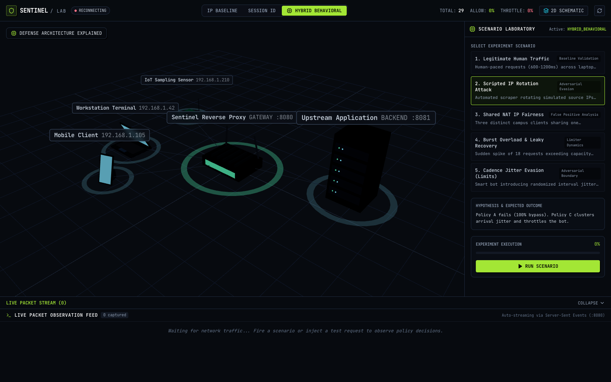
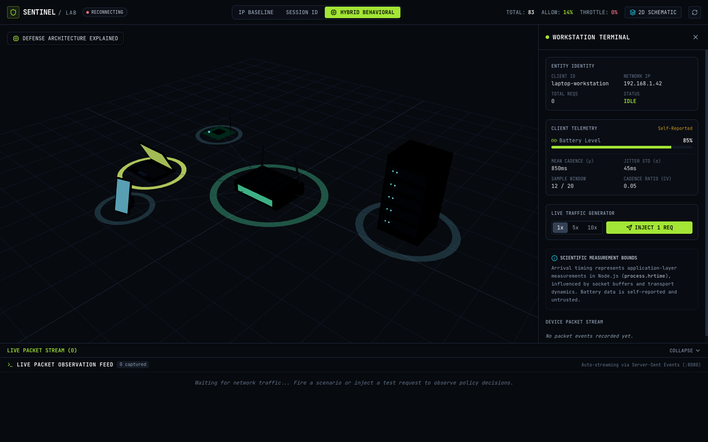
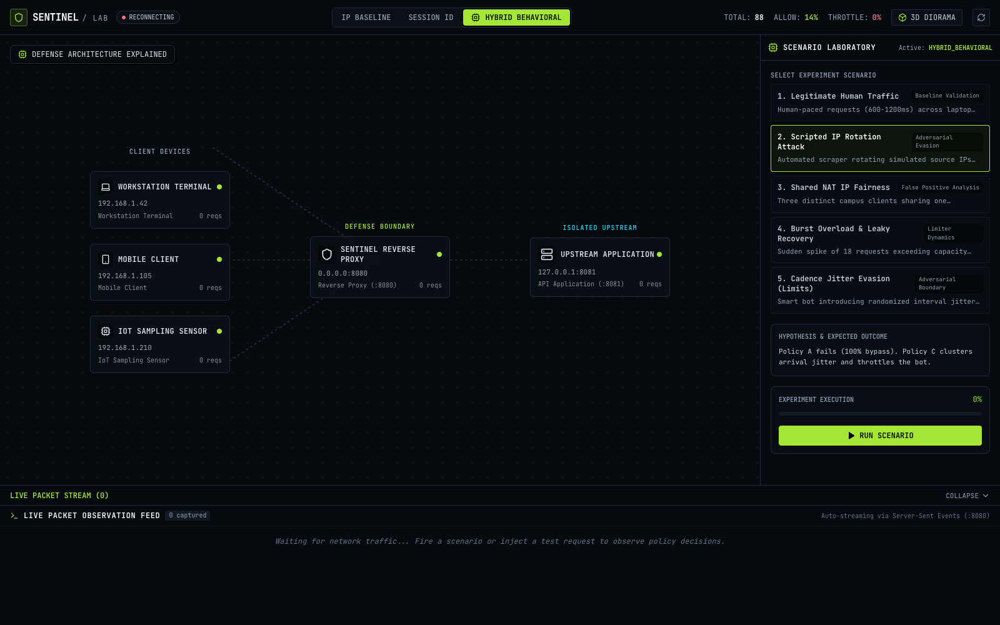
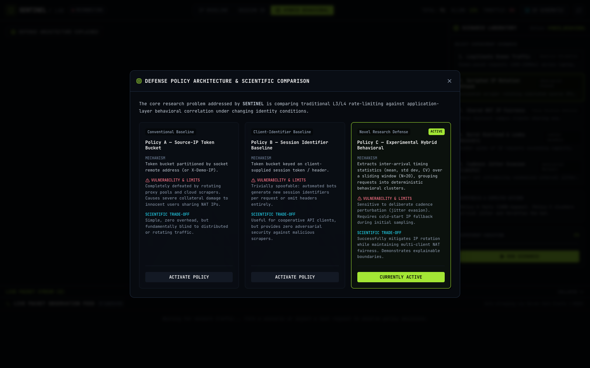

# SENTINEL / NETWORK LAB

**Explainable Network Traffic Defense Workbench & Edge Reverse Proxy**  
*Evaluating Probabilistic Behavioral Correlation vs. Conventional Rate-Limiting Policies*

---

## Visual Laboratory Interface



```
┌──────────────────────────────────────────────────────────────────────────────────────────┐
│                               SENTINEL / NETWORK LAB                                     │
│  [IP BASELINE]        [SESSION ID BASELINE]        [HYBRID BEHAVIORAL (ACTIVE)]          │
├───────────────────────────────┬──────────────────────────────────────────────────────────┤
│                               │  CONTEXTUAL INSPECTOR / SCENARIO STUDIO                  │
│   3D ISOMETRIC DIORAMA        │  ▸ Selected: Workstation Terminal (192.168.1.42)         │
│   ▸ Workstation Laptop        │  ▸ Mean Cadence (μ): 850ms | Jitter Std (σ): 45ms        │
│   ▸ Mobile Phone              │  ▸ Battery Level: 85% [Charging: YES]                    │
│   ▸ IoT Sensor Hub            │  ▸ Token Bucket: 8.00 / 10.0 [Refill: 2.0/s]             │
│   ▸ Sentinel Reverse Proxy    │  ▸ Ground Truth Accuracy: 96.0% | FPR: 0.0% | FNR: 4.0%  │
│   ▸ Upstream Application      │                                                          │
├───────────────────────────────┴──────────────────────────────────────────────────────────┤
│  LIVE PACKET FEED (Server-Sent Events)                                                   │
│  23:10:04 | GET /protected/api/data | 192.168.1.42 | Cluster: 298861943b44 | ALLOW  | 2ms │
│  23:10:05 | GET /protected/api/data | 198.51.100.4 | Cluster: 298861943b44 | THROTTLE| 429 │
└──────────────────────────────────────────────────────────────────────────────────────────┘
```

| Contextual Hardware Inspector | Accessible 2D Topology Fallback |
| :---: | :---: |
|  |  |

| Defense Architecture Matrix | Benchmark Comparison Studio |
| :---: | :---: |
|  | High-contrast neo-brutalist experimentation studio with real-time confusion metrics. |

---

## 1. Executive Summary & Research Motivation

Conventional web application rate limiters rely on two brittle assumptions:
1. **Network-Layer Source IP (L3/L4):** Trivial for modern scraping infrastructure to bypass by rotating through residential proxy pools, VPNs, or cloud subnets. Simultaneously, it unfairly penalizes multiple legitimate clients sharing a single carrier-grade NAT gateway.
2. **Application-Layer Session Tokens (L7):** Easily cleared, rotated, or omitted by automated headless scripts.

**SENTINEL / NETWORK LAB** investigates **probabilistic behavioral correlation** to mitigate automated attacks that rotate source IPs. Rather than claiming to identify permanent silicon hardware, Sentinel extracts application-visible arrival timing statistics ($\mu, \sigma, CV$) and optional client telemetry, mapping requests into deterministic observation clusters. Permitted traffic is actively forwarded through a genuine HTTP reverse proxy to an independent upstream service; abusive traffic is throttled at the gateway edge with HTTP 429.

---

## 2. Core Scientific & Engineering Principles

1. **Genuine Reverse Proxy Pipeline:**  
   Unlike synthetic dashboards, Sentinel is an active HTTP reverse proxy (`apps/gateway`). Requests to `/protected/*` are evaluated by the policy engine; permitted traffic is proxied to an independent backend service (`apps/upstream` on port 8081); throttled traffic receives HTTP 429 directly at the gateway without reaching upstream resources.
2. **Scientific Honesty & Boundary Disclosures:**  
   - Arrival intervals represent application-layer measurements in Node.js (`process.hrtime.bigint()`), influenced by kernel socket buffers and network jitter, not hardware-level clock ticks.
   - SHA-256 serves as an exact deterministic digest of normalized feature inputs; it is an identifier, not a machine-learning classifier.
   - `X-Demo-IP` is strictly labeled simulation metadata for reproducible benchmarks. Real client addresses use socket `remoteAddress`.
   - Battery level and charging status are self-reported, untrusted client inputs with explicit browser availability limitations.
   - The workbench explicitly demonstrates where behavioral defenses fail (e.g. cadence jitter evasion).
3. **Reproducible Benchmarks & Ground Truth:**  
   All 5 experimental scenarios run on deterministic PRNG seeds (Mulberry32), reporting quantitative false-positive rates (FPR), false-negative rates (FNR), true positives (TP), and proxy latencies.

---

## 3. Defense Policies Under Evaluation

Sentinel provides runtime policy switching between three distinct rate-limiting strategies:

```
                                  INCOMING REQUEST
                                         │
                                         ▼
                     ┌───────────────────────────────────────┐
                     │          ACTIVE POLICY ENGINE         │
                     └───────────────────┬───────────────────┘
                                         │
         ┌───────────────────────────────┼───────────────────────────────┐
         ▼                               ▼                               ▼
 ┌───────────────┐               ┌───────────────┐               ┌───────────────┐
 │   POLICY A    │               │   POLICY B    │               │   POLICY C    │
 │  Per-IP Token │               │  Session-ID   │               │ Experimental  │
 │    Bucket     │               │    Bucket     │               │ Hybrid Cluster│
 └───────┬───────┘               └───────┬───────┘               └───────┬───────┘
         │                               │                               │
         │ Key: Socket/Simulated IP      │ Key: Client-Supplied Header   │ Key: Cadence Cluster ID
         │ Vulnerability: IP Rotation    │ Vulnerability: ID Rotation    │ Jitter & Telemetry
         │ Fails on: Residential Proxies │ Fails on: Stateless Bots      │ Safety Fallback: IP Baseline
         │                               │                               │
         └───────────────────────────────┼───────────────────────────────┘
                                         │
                                         ▼
                                 [ TOKEN BUCKET ]
                                Capacity: C = 10.0
                              Refill: r = 2.0 tokens/s
                                         │
                        ┌────────────────┴────────────────┐
                        ▼                                 ▼
                 [ TOKENS >= 1.0 ]                 [ TOKENS < 1.0 ]
                        │                                 │
                        ▼                                 ▼
             HTTP 200 / FORWARD                   HTTP 429 THROTTLE
         Forward to Upstream Service             Blocked at Gateway Edge
         (apps/upstream on port 8081)           (Upstream Not Contacted)
```

1. **Policy A — Source-IP Token Bucket (Conventional Baseline):**  
   Partitions rate quotas strictly by IP address. Vulnerable to IP rotation; starves legitimate users behind shared NAT gateways.
2. **Policy B — Session Identifier Baseline:**  
   Partitions rate quotas by explicit client session headers. Honestly labeled as spoofable.
3. **Policy C — Experimental Hybrid Behavioral Defense:**  
   Extracts rolling inter-arrival mean ($\mu$), standard deviation ($\sigma$), and coefficient of variation ($CV$) over a sliding window ($N=20$). Quantizes statistical features and combines them with optional telemetry into a deterministic cluster ID. During cold-start ($N < 4$), it safely falls back to IP baseline rate limiting.

---

## 4. Five Deterministic Scenarios & Benchmark Findings

Sentinel ships with 5 reproducible local scenarios evaluated on identical trace workloads:

| Scenario | Focus | Policy A (IP) | Policy B (Session) | Policy C (Behavioral) | Scientific Finding |
| :--- | :--- | :---: | :---: | :---: | :--- |
| **1. Legitimate Workload** | Human web browsing | **0% FPR** | **0% FPR** | **0% FPR** | Natural human intervals (600-1200ms) allow continuous token replenishment across all policies. |
| **2. Scripted IP Rotation** | High-rate scraper rotating IPs | **100% FNR** *(Bypass)* | 0% FNR | **0% FNR** *(Mitigated)* | Policy A fails completely because each rotated IP gets fresh tokens. Policy C groups requests by arrival cadence and throttles the bot. |
| **3. Shared NAT Fairness** | 3 users sharing one external IP | 60% FPR *(Starvation)* | **0% FPR** | **Preserved** | Policy A exhausts shared quota, causing severe collateral damage. Policy C isolates cadences and maintains throughput. |
| **4. Burst & Recovery** | 18 requests at 15ms interval | 72% Accuracy | 72% Accuracy | 72% Accuracy | Demonstrates mathematically predicted bucket depletion ($C=10$) and linear time-based replenishment at 2.0 tokens/s. |
| **5. Jitter Evasion (Limits)** | Bot injecting 80-400ms random delay | 100% FNR | 40% FNR | **100% FNR** *(Drift)* | **Honest Boundary Case:** Deliberate inter-arrival noise prevents convergence to a single cluster, illustrating the limits of statistical classification. |

---

## 5. Monorepo Architecture

```
cn-project/
├── apps/
│   ├── gateway/                 # Reverse proxy, policy engine, SSE stream, static host (:8080)
│   │   ├── runner.js            # Dual-service orchestrator booting Gateway + Upstream
│   │   └── server.js            # HTTP proxy, policy evaluation, SSE bus, static bundle host
│   ├── upstream/                # Independent application service backend (:8081)
│   │   └── server.js            # Real API endpoints (/health, /api/data, /api/compute)
│   └── web/                     # Interactive 3D Web Workbench (React + Three.js + Tailwind)
│       ├── src/components/canvas/    # 3D isometric diorama & procedural hardware models
│       ├── src/components/diorama/   # Accessible 2D SVG topology schematic fallback
│       ├── src/components/layout/    # Master header, telemetry drawer, status indicators
│       ├── src/components/studio/    # Scenario launcher, confusion matrix, packet feed
│       └── src/components/timeline/  # Step-by-step event scrubber timeline
├── packages/
│   ├── contracts/               # Shared TypeScript schemas, DecisionEvent DTOs, policy enums
│   └── core/                    # Token bucket state machine, SignalExtractor, PolicyEngine
├── legacy/
│   └── review1/                 # Preserved original Review-1 standalone prototype & test suites
├── scripts/
│   ├── scenarios/               # Deterministic seed-based scenario generator & test runner
│   └── run-all-benchmarks.js    # Automated benchmark suite generating JSON & CSV reports
├── reports/                     # Exported benchmark evaluations and confusion matrices
├── docs/                        # Specifications, architectural briefs, and UI screenshots
├── tests/                       # End-to-end vertical slice integration test suite
└── package.json                 # Monorepo workspaces and unified execution scripts
```

---

## 6. Getting Started & Verification

### Prerequisites
- Node.js v18+ (tested on Node.js v24.2.0)
- npm v9+

### Quick Start
```bash
# 1. Install root & frontend dependencies
npm install --prefix apps/web

# 2. Build the production 3D web application
npm run build --prefix apps/web

# 3. Boot both Gateway Reverse Proxy (:8080) and Upstream Service (:8081)
npm start
```
Open **[http://localhost:8080/](http://localhost:8080/)** in your browser.

---

### Running the Test Suites
```bash
# Run all test suites (Legacy Review-1 tests + Core Unit tests + End-to-End Vertical Slice):
npm test

# Run isolated core state machine & statistics unit tests:
npm run test:core

# Run the end-to-end reverse proxy & SSE vertical slice test:
npm run test:vertical-slice

# Run the legacy Review-1 unit and mock pipeline tests:
npm run test:legacy
```

---

### Executing Academic Benchmarks & Generating Reports
```bash
# Execute all 5 deterministic scenarios and export JSON/CSV reports to reports/
npm run benchmark
```

---

## 7. Viva & Academic Defense Guide

1. **How does Sentinel handle NAT clients without silicon hardware IDs?**  
   *Answer:* It clusters application-visible arrival cadence and optional client telemetry. In cold start ($N < 4$), it uses an IP baseline fallback. When timing stabilizes, requests cluster into distinct buckets.
2. **What happens if an attacker randomizes their arrival jitter?**  
   *Answer:* As demonstrated in Scenario 5, deliberate high jitter ($CV > 0.5$) fragments clusters. Sentinel discloses this boundary honestly rather than fabricating perfection.
3. **Is this a real reverse proxy?**  
   *Answer:* Yes. Permitted requests are actively forwarded over HTTP to `http://127.0.0.1:8081`, and upstream response headers and payloads are streamed back to the client. Throttled requests are stopped at the gateway edge with HTTP 429.
